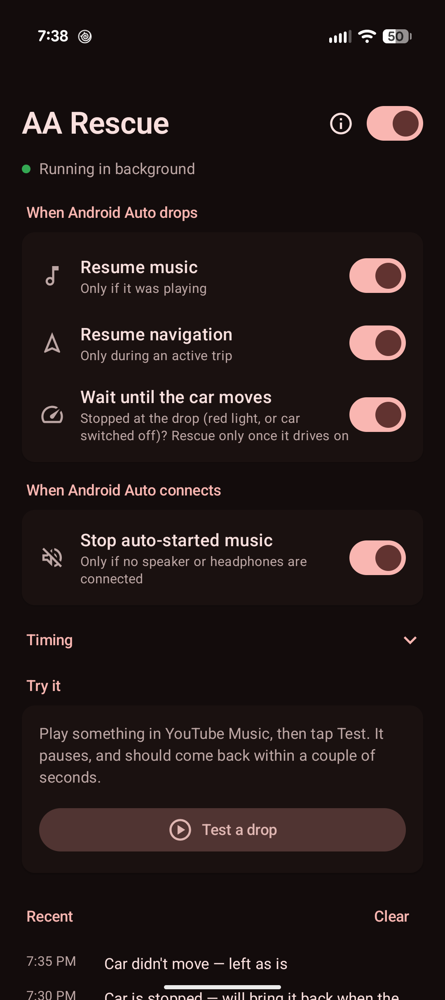
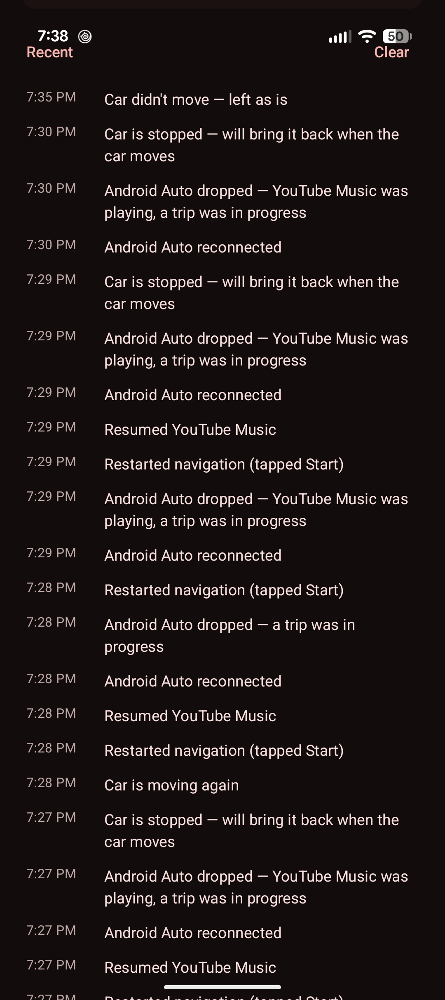
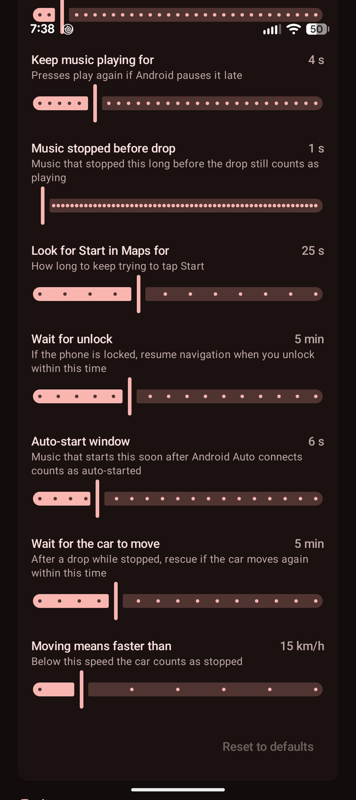

# AA Rescue

A wireless Android Auto screen that drops mid-drive takes your music and your navigation
with it: Android pauses the music and Google Maps falls out of turn-by-turn. AA Rescue
runs in the background, notices, and puts things back. Nothing that was off gets turned on.

<p align="center">
  
  &nbsp;
  
  &nbsp;
  
</p>

## What it does

**When Android Auto drops**

| Rescue | What happens | Only if |
|---|---|---|
| **Resume music** | Presses play again on the app that was playing, and keeps it playing if Android pauses it late. Sound comes out wherever it was going: your Bluetooth speaker or headphones if connected, otherwise the phone. | It was playing when the screen dropped |
| **Resume navigation** | Brings Google Maps to the front on the phone and taps **Start** / **Restart**, so turn-by-turn carries on even if the car screen never comes back. If the phone is locked, it does this as soon as you unlock. | A trip was in progress |
| **Wait until the car moves** | Tells a glitch from the car being switched off. Moving at the drop: rescue right away. Stopped (red light, or you turned the car off): wait, and rescue only if the car drives on within 5 minutes. A switched-off car never moves again, so nothing starts playing and Maps doesn't pop up. | Location is allowed; otherwise every drop is rescued right away |

If Android Auto reconnects by itself, AA Rescue stands down and leaves the session alone.

**When Android Auto connects**

| Rescue | What happens | Only if |
|---|---|---|
| **Stop auto-started music** | Android Auto's "Start music automatically" presses play on connect. On a screen that leaves the sound on the phone, that plays from the phone's own speaker; AA Rescue pauses it again. | No Bluetooth speaker, headphones, wired output or car-screen audio is available. Music you were already playing is left alone |

**Controls**

- Each rescue has its own toggle, and the switch at the top pauses all of them
  ([pausing vs. turning off completely](docs/info.png)).
- **Timing** adjusts the delays: reaction delay, how long to keep music playing, how long to
  look for Start in Maps, how long to wait for an unlock or for the car to move, the
  auto-start window, and the speed that counts as moving (15 km/h by default).
- **Recent** shows, in plain words, what happened at each drop and what was done about it.
- **Test a drop** fakes a drop so you can see music come back without a car.

## Privacy

- **No internet permission.** Nothing the app sees can leave the phone.
- **Accessibility is scoped to Google Maps.** It only receives events from Maps
  (`res/xml/maps_clicker.xml`), only reads the screen while Maps is the app in front,
  and only acts for ~25 seconds after a drop, looking for a "Start"/"Resume" button.
  Android shows its generic "full control" warning for every accessibility app regardless.
- **Location (Allow all the time)** is used for one thing: the car's speed, read only from
  the moment Android Auto connects until a drop has been dealt with. Positions aren't stored
  or logged. Without it (or with *Wait until the car moves* off) every drop is rescued
  right away, as in earlier versions.
- **Notification access** is used to press play on the music app and to see whether
  Maps has an active trip notification.

## Install

Download the APK from the [latest release](../../releases/latest) (or
`release/aa-rescue-0.1.8.apk` in this repo) to the phone and open it (allow installs from that
source), or with adb:

```sh
adb install -r release/aa-rescue-0.1.8.apk
```

Then open AA Rescue and finish Setup:

1. **Music control** — Notification access → AA Rescue → on.
2. **Maps auto-Start** — Accessibility → AA Rescue → on. If it's greyed out:
   App info → ⋮ → *Allow restricted settings*, then try again.

3. **Car movement** — Location → Precise, then *Allow all the time* (tap **Turn on** twice).

Tip: if your phone has a PIN, add the car screen's Bluetooth (or your speaker) under
Extend Unlock → Trusted devices, so Maps can be opened after a drop.

The APK is signed with a debug key (personal sideload build, not for the Play Store).
0.1.7 and later are signed with a different debug key than 0.1.6 and earlier, so they can't
update those in place: uninstall the old version first, then redo Setup.

## Build

```sh
./gradlew assembleRelease   # app/build/outputs/apk/release/app-release.apk
```

Read the app's trace log (adb only):

```sh
adb shell dumpsys activity service dev.nish.aarescue/.MediaWatcher
```

Integration tests with a real Android Auto session (Desktop Head Unit) and real drops:
setup, process, scenarios and latest results are in
[docs/INTEGRATION_TESTS.md](docs/INTEGRATION_TESTS.md).

```sh
scripts/e2e.sh <adb-serial> music_nav   # music + navigation must come back after the drop
scripts/e2e.sh <adb-serial> nothing     # nothing playing → nothing gets started
```

Scenario matrix (no trip / trip, music on / off, another app in front, instant reconnect,
back-to-back drops), checking the phone's real state after each drop:

```sh
scripts/matrix.sh <adb-serial>           # s1..s6, s9, s10
```

Fake a drop for testing (adb only):

```sh
adb shell am broadcast -n dev.nish.aarescue/.DebugDropReceiver --ez nav true
```

Fake the car's speed in km/h (adb only; negative goes back to GPS). At 0 a drop waits, and
raising it releases the rescue:

```sh
adb shell am broadcast -n dev.nish.aarescue/.DebugDropReceiver --ef speed 0
adb shell am broadcast -n dev.nish.aarescue/.DebugDropReceiver --ef speed 30
```

Fake a connection (adb only), then start music within the auto-start window to see it
paused when no speaker is connected:

```sh
adb shell am broadcast -n dev.nish.aarescue/.DebugDropReceiver --ez connect true
```
